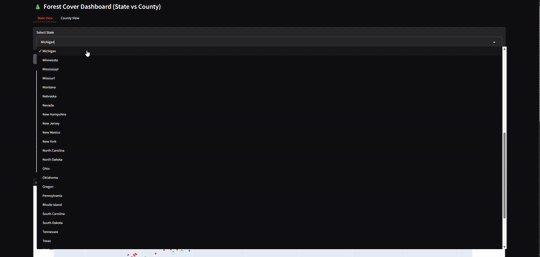

# tree-canopy

We forecast forest canopy change using a binary classification target:

**High Canopy Growth** – The classification compares forest canopy change between 2015 and 2019 (a 4-year period), and counties with a ≥5% increase are labeled as high growth (1), others as 0.
**Stable/Declining** – All other counties.

## Forest Canopy Change as Target

The target is produced by [`pipeline/canopy-process.py`](pipeline/canopy-process.py), which replaced the original Forest Canopy colab in October 2026. It pulls `LandCoverFraction_Forest` ("Percent of Forest Covered Area", Copernicus-derived) for every U.S. county from the [Data Commons API](https://datacommons.org/browser/LandCoverFraction_Forest), keeps the most recent years, and writes two files:

- `input/targets/forest-canopy-timeseries-<first>-<last>.csv`: one row per county (`Fips`, `Name`), one column per year, percent forest cover.
- `input/targets/forest-canopy-target.csv`: `Fips`, `Target`, where `Target` is 1 when relative growth between the first and last year of the window is at or above the threshold (5 percent by default), otherwise 0.

The earlier output, [`input/targets/forest_canopy_data_target.csv`](input/targets/forest_canopy_data_target.csv), was made once by the colab for 2015 to 2019 and is kept for the existing parameter files. The timeseries file that the RealityStream canopy parameters referenced was never generated by the colab; the script now produces it.

### Run it

    pip install datacommons-client pandas
    python pipeline/canopy-process.py                    # last 5 available years, 5 percent threshold
    python pipeline/canopy-process.py --years 4 --threshold 5
    python pipeline/canopy-process.py --check            # offline self-check, no key needed

It needs `DATACOMMONS_API_KEY` (request one at [apikeys.datacommons.org](https://apikeys.datacommons.org/)), read from the environment, the OS credential store ([realitystream/api/keystore.md](https://github.com/ModelEarth/realitystream/blob/main/api/keystore.md)), or the `.env` named by `automation/paths.yaml` in the webroot.

### Processing steps

1. Fetch every observation of `LandCoverFraction_Forest` for entities of type County under `country/USA`.
2. Clean FIPS to 5-digit text, strip " County" from names.
3. Keep the last N available years (`--years`), pivot to one row per county.
4. `relative_growth = (last - first) / first * 100`; `Target = 1` where `relative_growth >= threshold`.
5. Write both CSVs to `input/targets/`.

View the timeseries on the [timeline page](https://model.earth/localsite/timeline/#goal=biodiverse&scope=county&features.dcid=LandCoverFraction_Forest) (Data Commons variable `LandCoverFraction_Forest`). Models are run from the [RealityStream Run Models page](https://model.earth/realitystream/models/) with the Forest Canopy parameters.

---

## How It Works

The `.csv` file is used as a **target input** for ML models predicting forest canopy trends based on other features (e.g., economic activity).

You can plug this into any modeling workflow by referencing the parameter YAML described below.

---


---

## 🔎 Workflow Overview (with the CSV)

1. **Target Formation**
   - Extract U.S. county metadata via FIPS codes.
   - Retrieve Copernicus-derived forest cover data.
   - Calculate relative growth:
     ```python
     relative_growth = ((recent - start) / start) * 100
     ```
   - Label counties as High Growth (1) or Stable/Declining (0).

2. **Mathematical Analysis**
   - Rank counties by canopy change.
   - Identify **top 10 counties per state** with largest decreases.

3. **Preprocessing for EDA**
   - Clean FIPS codes, merge metadata.
   - Drop unrelated features, handle missing values.
   - Reshape data into **long format** for time-series models.

4. **Predictive Modeling**
   - **Linear Regression** (`sklearn`) for trend fitting.  
   - **ARIMA** (`statsmodels`) for 5-year canopy forecasts.  
   - Rolling-window validation used for robustness.

5. **Statewise Pipelines**
   - Group counties by state for **localized forecasting**.
   - Outputs structured for visualization.

6. **Interactive Dashboard **
   - Outputs structured for visualization.
   - Added Gradio dashboard with dropdown menus for state + county selection.
   - Interactive plots show forest canopy trends.
   - Integrated maps display canopy growth/decline at the county level.
   - Automatically highlights top 10 declining counties per state.

   

---
## Target YAML Configuration

[`forest_canopy_config.yaml`](https://github.com/ModelEarth/tree-canopy/blob/main/parameters/forest_canopy_config.yaml) – YAML configuration for using this dataset as a model target.

```yaml
folder: naics6-forestcanopy-counties-simple
features:
  data: industries
  common: Fips
  path: https://raw.githubusercontent.com/ModelEarth/community-timelines/main/training/naics2/US/counties/2020/US-ME-training-naics2-counties-2020.csv
targets:
  data: forest_canopy
  path: https://raw.githubusercontent.com/ModelEarth/tree-canopy/main/input/targets/forest_canopy_data_target.csv
models: rbf

